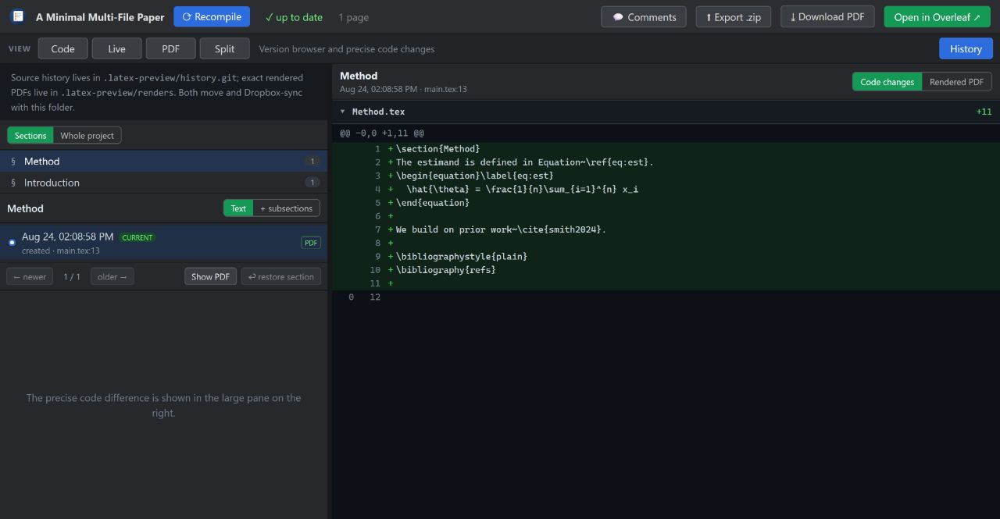
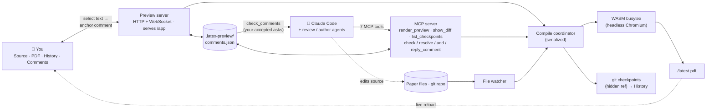

# TeXChronicle — section-aware LaTeX history and live editing

[](LICENSE)

**English** · [简体中文](docs/i18n/README.zh-CN.md) · [日本語](docs/i18n/README.ja.md) · [한국어](docs/i18n/README.ko.md) · [Español](docs/i18n/README.es.md) · [Français](docs/i18n/README.fr.md) · [Deutsch](docs/i18n/README.de.md) · [Português](docs/i18n/README.pt.md)

**TeXChronicle** is a human-first LaTeX workspace for editing, rendering, and
recovering papers. It combines a source editor, editable Live document view,
exact PDF preview, anchored comments, and section-aware Git history in one
browser window. Every successful compile records the source and its exact PDF,
without changing the paper's normal Git branches.

It works on its own—an LLM is optional. Claude Code, Codex, and other
MCP-compatible agents can edit the same files or act on comments when useful.
The portable Windows build includes its own compiler, browser runtime, Node, and
Git, so recipients do not need a local TeX installation or Overleaf account.



## The workspace

One browser window (inspired by Typst's one-surface editor and LiquidText's
anchored annotations):

```
┌──────────────────────────────────────────────────────────────┐
│  ✓ up to date · 13 pages        Export .zip · Download PDF   │
├────────────┬──────────────────────────────┬──────────────────┤
│ Source /   │          PDF (live)          │    Comments      │
│ History    │  select text → 💬 comment    │  accepted → ask  │
│  editor,   │  highlights stay anchored    │  Claude to       │
│  timeline  │  auto-reloads on every edit  │  address them    │
│  + diffs   │                              │  → resolved ✓    │
└────────────┴──────────────────────────────┴──────────────────┘
```

- **Comment → Claude loop (the point of it all).** Review the *rendered* document
  like a supervisor marking up a printout: select text, attach a comment
  ("tighten this paragraph"). Then tell Claude to *"address my comments"* — it
  pulls them via `check_comments` as **located work items** (page + quoted passage
  + the source `file:line` it anchors to + your ask), edits the source, and
  resolves each card with a note. You interact with the document; Claude interacts
  with the source. Run it hands-off with `/loop` — see
  [`docs/AGENT-LOOP.md`](docs/AGENT-LOOP.md).
- **Editable source panel.** A CodeMirror LaTeX editor with the project's files —
  save (Ctrl+S) recompiles and refreshes the PDF, Typst-style. Or keep using your
  own editor: any save triggers the same live loop. **Code**, **Live**, and
  **PDF** are full-canvas selectable workspaces. Live turns ordinary academic
  LaTeX into an editable document immediately (headings, prose, citations, footnotes,
  lists, equations, figures, and tables). Editing a word changes only its exact source
  span; math, citations, references, commands, comments, and untouched formatting remain
  byte-for-byte intact. Protected constructs stay visible and open in Code; PDF remains exact.
  **Split** keeps source or Live beside PDF when comparison is useful.
- **PDF → exact source.** Click a point in a PDF produced by the local TeX backend
  to open the corresponding source file and line via SyncTeX. Visible-text
  refinement handles macro-expanded title/author blocks, and remains a best-effort
  fallback when the bundled WASM backend has no SyncTeX map.
- **Live reload.** A file watcher recompiles on every save — Claude's edits, the
  built-in editor's, or your external editor's.
- **Section-aware change history.** Each successful compile is auto-snapshotted
  to a **hidden git ref** (`refs/latex-preview/checkpoints`) — never touching your
  branches, `git log`, or working tree. Restore also captures a reversible safety
  snapshot first, while a separate marker ensures that unrendered recovery state
  is never mistaken for a successful PDF. History follows every section and
  subsection across edits, renames, and moves using labels plus fuzzy matching.
  Browse its own timeline, compare only its text (or its whole subtree), restore
  that part without rolling back the rest of the paper, and reopen the exact PDF
  produced at that checkpoint. A whole-project timeline remains available too.
- **Get to Overleaf.** **Download PDF**, **Export .zip** (clean build-inputs
  bundle), and a one-click **Open in Overleaf** link for public GitHub repos;
  Premium Git-bridge sync is a documented `git push`. See [`docs/USER-GUIDE.md`](docs/USER-GUIDE.md).
- **Review workflow (reviewer → gate → resolver).** A reviewer/defender agent posts
  comments via `add_comment`; you **Accept/Reject** them (or flip *Auto-accept* for
  copilot mode); an author loop resolves the accepted ones. Comments carry roles and
  a reply thread. See [`docs/AGENT-LOOP.md`](docs/AGENT-LOOP.md).
- **Save vs. recompile, your call.** The built-in editor auto-saves every 30s without
  recompiling; **Ctrl+S** / **Save** / **Recompile** rebuild the PDF on demand. (Flip
  **⚡ Live** for recompile-as-you-type.) Your own editor and Claude's edits still
  auto-recompile via the watcher.
- **Real projects.** Auto-detects the main file, gathers multi-file
  `\input`/`\include`, `.bib`, in-repo `.cls`/`.sty`/`.bst` and figures, runs
  BibTeX and reruns when needed; common missing packages are auto-injected.
- **Compile backend.** Uses your local **latexmk** when you have one — full package
  fidelity, output matching Overleaf — and the bundled zero-install **WASM** TeX Live
  when you don't. Force either with `backend: "system"` / `"wasm"`. Every compile
  reports which one ran.
- **Document classes.** `IEEEtran` is bundled, because no venue class ships in the
  WASM TeX Live and a missing class can't be worked around the way a package can.
  Conference classes (NeurIPS, ICML, CVPR, ACL, AAAI …) carry no redistributable
  licence, so put the `.cls` from the author kit beside your source — it's picked up
  automatically.
- **MCP tools:** `render_preview` (compile + open the workspace), `check_comments` /
  `resolve_comment` / `add_comment` / `reply_to_comment` (the review loop), `show_diff`
  (side-by-side diff as an image — useful on image-capable clients).
- **Actionable errors.** Failed compiles return parsed `{file, line, message}`
  errors so Claude can self-correct, and show in the workspace.

## Run the editor without an LLM

### Portable Windows edition (no installation)

Download `TeXChronicle-<version>-Portable-Windows-x64.zip` from the release, extract
the whole folder, and double-click **`TeXChronicle.exe`**. It includes its own Node
runtime, Git, headless Chromium, and the complete BusyTeX asset bundle, so the
recipient does **not** install npm, Node, Git, Perl, or TeX and the first compile
does not need a download. Choose a recent paper, browse to its main `.tex` file,
or drag that file onto `TeXChronicle.exe`.

This is a portable folder, not an installer: keep its subfolders beside the EXE.
The paper's checkpoints, comments, and saved render PDFs remain in the paper's
`.latex-preview` directory, so Dropbox or another ordinary folder synchronizer
carries them across machines. One machine at a time: let the sync finish before
opening the same paper elsewhere; two machines editing the same paper offline can
fork its checkpoint history. See [the portable Windows guide](docs/PORTABLE-WINDOWS.md)
for sharing, checksums, updates, limitations, and the reproducible build command.

### One-click launcher (Windows)

After installing/linking TeXChronicle, install its desktop and Start-menu shortcut once:

```bash
texchronicle install-launcher
```

After that there is no project command to remember: click **TeXChronicle** and its
**Recent projects** window lists papers you opened before, with **Browse…** for a
new main `.tex` file. Double-click a paper and the browser workspace opens. You can
also drag a `.tex` file onto the desktop shortcut. Opening an already-running paper
reuses its existing workspace instead of starting a competing compiler. The small status window keeps the
local workspace alive; close it when you are finished. `texchronicle open` presents the
same recent-project chooser.

### Terminal launch

From a source checkout, install and link TeXChronicle once:

```bash
npm install
npm run build:ui
npm link
```

`npm run build:ui` builds the browser workspace. Without it a fresh clone falls
back to the basic viewer — a PDF pane with no editor, History, or comments.

Then run it from any LaTeX project directory:

```bash
cd /path/to/paper
texchronicle preview main.tex
```

The browser workspace opens and stays live while that terminal is running.
Use **⚡ Live** for recompile-as-you-type, or **Ctrl+S** to save and compile.
Every clean render is recorded in History. Press **Ctrl+C** to stop. For a
project elsewhere, use `texchronicle preview --project /path/to/paper main.tex`.

Claude Code, Codex, and other MCP clients are optional: they can edit the same
files while this standalone workspace is running, but they are not needed to
open or use it.

## Setup with an LLM/MCP client

The package and MCP metadata now use `texchronicle` and
`io.github.Aliutin/texchronicle`. Neither the npm package nor the renamed GitHub
repository is published yet — `npm view texchronicle` is a 404 and
`github.com/Aliutin/TeXChronicle` is "Repository not found" — so an MCP client
has to be pointed at this source checkout:

1. **Prepare the checkout** (once, in the TeXChronicle folder):

   ```bash
   npm install
   npx --no-install playwright install chromium --only-shell
   npm run build:ui
   ```

   `npm install` does *not* download a browser — Playwright has no postinstall
   hook — and it does not build the workspace UI either. Skip the second command
   and the first diff or WASM compile fails; skip the third and the preview opens
   the basic viewer instead of the workspace.

2. **Add it to your paper project's `.mcp.json`** (see [`.mcp.json.example`](.mcp.json.example)):

   ```json
   {
     "mcpServers": {
       "texchronicle": {
         "command": "node",
         "args": ["/absolute/path/to/TeXChronicle/bin/cli.mjs"]
       }
     }
   }
   ```

   Go through `bin/cli.mjs` rather than `npx tsx src/server.ts`: the entry script
   is what checks your Node version and says so in plain words when it is too
   old, and what preloads the `os.userInfo` fallback some Windows accounts need.
   Called directly, `src/server.ts` skips both and fails in ways an MCP client
   reports only as `-32000`.

   After an npm release, the shorter command will be
   `"command": "npx", "args": ["-y", "texchronicle"]`.

3. **Restart Claude Code** (or `/mcp` reconnect) so it picks up the server.

4. **Ask Claude to render.** e.g. *"render a preview of this paper"* → the first call
   downloads the WASM TeX Live assets (~650 MB, one time), compiles, and opens the
   live preview tab. Subsequent edits reload it automatically.

### Which folder does it use?

The one the server was started in. Claude Code and Codex start an MCP server in
the project directory, so a `.mcp.json` sitting next to your paper needs nothing
further. Some clients — Claude Desktop among them — start their servers from your
home directory instead, and there the server has no paper to compile. Name the
folder explicitly in that case, either in the server's config entry:

```json
{
  "mcpServers": {
    "texchronicle": {
      "command": "node",
      "args": ["/absolute/path/to/TeXChronicle/bin/cli.mjs"],
      "env": { "TEXCHRONICLE_PROJECT": "/absolute/path/to/paper" }
    }
  }
}
```

or as a server argument: `"args": ["/abs/path/to/TeXChronicle/bin/cli.mjs", "--project", "/abs/path/to/paper"]`.
A server started somewhere that holds no `.tex` file says so and stops, rather
than watching that folder or creating a history store in it.

The WASM assets are **not** in this repo. They're fetched on first run into a
per-user cache — `~/Library/Caches/texchronicle` on macOS, `$XDG_CACHE_HOME/texchronicle`
on Linux, `%LOCALAPPDATA%\texchronicle` on Windows — so upgrading TeXChronicle doesn't
re-download them, and a checkout, a global install and an `npx` run share one copy.
Set `TEXCHRONICLE_ASSETS_DIR` to put them elsewhere. To pre-fetch:
`npx texlyre-busytex download-assets <that directory>`.

## Install as a Claude Code plugin (slash commands)

After the renamed repository is published, the optional Claude Code plugin gives
you the MCP server **and** slash commands:

```
/plugin marketplace add Aliutin/TeXChronicle
/plugin install texchronicle
```

Then, in your paper project, use the **workflow commands** for the common flows:

- **`/texchronicle`** — compile and open the workspace (the live preview).
- **`/ai-review [skill]`** — review the paper with a skill (default
  `academic-paper-revision`; pass any skill name) and post comments for you to
  Accept/Reject. Missing skills are reported with an install hint.
- **`/address-comments`** — resolve your accepted comments (loop it with
  `/loop 60s /address-comments`).
- ⚡ **`/ultra-agents [skill] [depth]`** — fully autonomous: review, auto-accept, fix,
  repeat, up to `depth` rounds (default 2), stopping early the moment a round finds
  nothing new. No per-round approval — that's the point, and the risk. `depth > 5`
  asks you to confirm before starting. Ends with a summary (what was raised, what
  changed, which checkpoints to look at) — every round is still an ordinary,
  revertible checkpoint. See [`docs/AGENT-LOOP.md`](docs/AGENT-LOOP.md#ultra-agents).

### One command per tool

Every MCP tool also has a slash command with the **same name**, so you can drive any
single step by typing the tool name. The rule to teach: *the tool is `X` → type
`/X`.*

| Type this      | Runs tool         | What it does |
| -------------- | ----------------- | ------------ |
| `/render_preview` | `render_preview` | Compile the paper and open/refresh the live preview. |
| `/check_comments` | `check_comments` | List the comments you've accepted, as edit instructions (no edits yet). |
| `/resolve_comment [id] [note]` | `resolve_comment` | Mark a comment done after the edit; it turns **green** for your review. |
| `/add_comment ["quote"] [note]` | `add_comment` | Anchor a comment onto a passage for you to Accept/Reject. |
| `/reply_to_comment [id] [text]` | `reply_to_comment` | Add a threaded reply to a comment. |
| `/show_diff [checkpoint]` | `show_diff` | Side-by-side visual diff as an image (current changes, or a checkpoint). |
| `/list_checkpoints [limit]` | `list_checkpoints` | Recent checkpoints with their sha, newest first — find one to pass into `/show_diff`. |

You never *have* to type these — plain English works too (*"render a preview"*,
*"address my comments"*). The commands are just a fast, teachable shorthand.

> The slash commands come with the plugin: they are files in `commands/`, which
> only the plugin installs. The server itself registers no prompts, so a
> `.mcp.json` setup gives you the tools in the table below but no `/` shortcuts —
> you drive them in plain English instead (*"render a preview"*, *"address my
> comments"*), which is what the commands expand to anyway.

## Tools

The MCP surface, for any client that speaks MCP. (In Claude Code you can just ask in
plain English, or use the slash commands above — these are the underlying tools.)

| Tool | Parameters | What it does |
| ---- | ---------- | ------------ |
| `render_preview` | `mainFile?` · `engine?` (`pdflatex` \| `xelatex` \| `lualatex`, auto-detected when omitted) · `backend?` (`wasm` \| `system` \| `auto`, default `auto` — local latexmk if installed, else the bundled WASM engine) | Compiles the project and opens/refreshes the live workspace. The main file is auto-detected by scanning for `\documentclass` if omitted. |
| `check_comments` | `includeResolved?` (default `false`) | Returns the accepted comments as located work items — page, quoted passage, the source `file:line`, and the ask. Reviewer suggestions awaiting your decision are reported but not returned as work. |
| `add_comment` | `quote` · `comment` · `role?` (`reviewer` \| `defender`) · `page?` · `accepted?` | Anchors a comment onto a passage. Posts as a *suggestion* awaiting your Accept/Reject unless `accepted` is set — that flag is what makes autonomous mode autonomous. |
| `resolve_comment` | `id` · `note` | Marks a comment done after the edit, with one line describing what changed. It is accepted only when the current source exactly matches the latest successful rendered checkpoint, then turns **green** in the workspace for your review. |
| `reply_to_comment` | `id` · `text` · `role?` (`author` \| `reviewer` \| `defender`) | Adds a threaded reply, so a disagreement can be worked out on the comment instead of in chat. |
| `show_diff` | `checkpoint?` | Renders a side-by-side diff **as an image**, shown inline in the conversation. Defaults to the current uncommitted changes; pass a checkpoint sha for a saved version. |
| `list_checkpoints` | `limit?` (default 10, max 50) | Recent checkpoints with their sha, newest first — use it to find one to pass to `show_diff`. |

**The headline workflows are built on top of these, not among them.** `/texchronicle`,
`/ai-review`, `/address-comments` and ⚡ `/ultra-agents` are Claude Code plugin
commands that orchestrate the tools above — `/ultra-agents` chains review →
auto-accept → fix for as many rounds as you allow, and is the reason `add_comment`
takes an `accepted` flag. They are not part of the MCP surface, so another MCP client
sees the seven tools only. See [the plugin section](#install-as-a-claude-code-plugin-slash-commands)
and [docs/AGENT-LOOP.md](docs/AGENT-LOOP.md).

## See it in the terminal

These are real tool outputs, captured verbatim from an actual run against the sample
paper — not mocked up. This is what you see in Claude Code while the browser
workspace (screenshot above) reflects the same state live.

You type:
```
/texchronicle
```
Claude calls `render_preview` and replies:
```
✓ Compiled main.tex with xelatex in 1900ms — 2 files. Workspace (live preview,
source editor, history, PDF comments — auto-reloads on edits):
http://127.0.0.1:52042/app
```

You (or a reviewer skill) leave a comment, then ask what's ready to act on. Claude
calls `check_comments`:
```
1 accepted comment — edit each at its source location per the instruction, then
call resolve_comment with its id and a one-line note:

[id: 2fce9e3c8b5f] p.1 — "Sorting widgets efficiently is a long-standing problem"
  ↳ source: main.tex:15
  → Tighten this opening sentence.

(1 reviewer suggestion still awaits the human's accept in the workspace — not
actionable yet.)
```
Claude makes the edit and calls `resolve_comment`:
```
✓ Resolved comment 2fce9e3c8b5f ("Sorting widgets efficiently is a long-standing
problem…") — the card now shows: Rewrote the opening sentence.
```
Ask again, and the accepted queue is empty — only the still-unaccepted suggestion
remains, waiting on you:
```
No accepted comments. (2 already resolved.)

(1 reviewer suggestion still awaits the human's accept in the workspace — not
actionable yet.)
```

## How it works

```
Claude edits .tex ─┐
 file watcher ─────┼─▶ compile coordinator ─▶ headless Chromium ─▶ WASM TeX ─▶ PDF
 render_preview ───┘         (serialized)         (engine host)                │
                                                                               ▼
                     your workspace (/app)  ◀── WebSocket "reload" ◀── local HTTP server
                     Source · PDF · History · Comments        (serves /app + /latest.pdf)
```

The WASM engines need DOM/Worker globals, so the server hosts a hidden headless
Chromium as its compile worker; the workspace *you* open is a lightweight React +
pdf.js app with no WASM in it. See [`docs/ARCHITECTURE.md`](docs/ARCHITECTURE.md).



Both front doors — you in the workspace, agents through the 7 MCP tools — meet at
the same coordinator, comment store, and git history. You act on the *rendered
document* (anchor a comment); Claude acts on the *source* (reads your comments via
`check_comments`, edits, `resolve_comment`). That shared substrate is what makes
the comment loop, the review workflow, and traceable history possible.

## Requirements

The requirements below apply to the npm/source installation. The Windows
portable release carries these runtimes itself and needs only 64-bit Windows 10
or later plus a normal web browser for the workspace window.

- Node 20.19+ (the floor `chokidar` and `playwright` actually need; the server checks at startup and says so)
- Playwright's Chromium (~150–300 MB). It is **not** installed automatically —
  Playwright ships no postinstall hook — so run
  `npx --no-install playwright install chromium --only-shell` in the TeXChronicle
  folder once, or set it to reuse your installed Chrome.
- ~650 MB disk for the one-time WASM TeX Live assets — all of it fetched on the
  first run, in three package sets (basic 87 MB, recommended 190 MB, extra 324 MB,
  plus the 31 MB engine). A normal paper only *loads* the basic set; the larger two
  sit on disk until something needs them. Cached per user, not per install, so
  upgrading TeXChronicle doesn't re-download them. Override the location with
  `TEXCHRONICLE_ASSETS_DIR`.
- **A local TeX install is optional.** See below for when it matters.

### Do I need a local TeX distribution?

No — the bundled WASM engine compiles with nothing installed, which is the whole
point. But it ships a *subset* of TeX Live, so some things aren't in it: `svg`,
most venue document classes, and various less common packages. When one is
missing you'll be told, rather than handed a silently wrong PDF.

Install a distribution when you want output that matches Overleaf exactly.
TeXChronicle picks it up on its own — no configuration:

| | |
|---|---|
| macOS | [MacTeX](https://tug.org/mactex/) |
| Linux | `texlive-full`, via your package manager |
| Windows | [TeX Live](https://tug.org/texlive/), or [MiKTeX](https://miktex.org/) **plus** [Strawberry Perl](https://strawberryperl.com/) |

> `latexmk` is not installed on its own — it is a driver script that comes with
> the distributions above. On Windows, TeXChronicle also discovers the standard
> per-user/system MiKTeX and Strawberry Perl locations directly, so a stale or
> incomplete `PATH` does not force the bundled compiler. Elsewhere, check with
> **`latexmk -version`**, not `which latexmk`: finding the file does not prove it
> can run. On macOS you may need `eval "$(/usr/libexec/path_helper)"` or a fresh
> terminal first.

Every compile tells you which one ran — `xelatex · system` or `xelatex · wasm`.

## Development

```bash
npm install
npm run typecheck    # tsc for the server and the UI
npm run build:ui     # build the React workspace to ui/dist
npm test             # the unit suite — engine-free, no browser, seconds
npm start            # run the server on stdio (for a manual MCP client)
```

Two tiers, on purpose. `npm test` covers the comment store, anchor matching, line
and column geometry, the history repo, asset paths, compile-log classification, the
preview server's shutdown, and an MCP workflow E2E — all without a browser or a TeX
engine, so it stays fast and deterministic. CI (`.github/workflows/ci.yml`) runs
typecheck + UI build + that suite on Node 20 and 22 for every push and pull request.

The things a unit test structurally cannot see — highlight geometry at several zoom
levels, what a failed render actually tells the reader, whether shutting down closes
the server and warns any open window — live in `scripts/smoke-*.mjs` and run against
a real browser and a real compile in `.github/workflows/smoke-macos.yml`. Each of
those exists because something shipped broken that the unit suite was green through.
Please keep both green and add coverage with changes.

## Documentation

- [**User guide**](docs/USER-GUIDE.md) — everyday use, the comment loop, Live editing, the
  file tree, getting your paper into Overleaf, package coverage.
- [**The agent loop**](docs/AGENT-LOOP.md) — comments as triggers, running it hands-off with
  `/loop`, the reviewer → gate → resolver workflow, and ⚡ `/ultra-agents`.
- [**Roadmap**](docs/ROADMAP.md) — what's shipped for concurrent agents, and what real
  parallel multi-agent editing still needs.
- [**Architecture**](docs/ARCHITECTURE.md) — why a headless browser, what every module does,
  the compile flow.

All four are translated into the same 8 languages as this README — each page has its own
language switcher at the top.

## Roadmap

Multiple Claude Code sessions can already work the same project concurrently without
corrupting comments or the checkpoint history (see [`docs/ROADMAP.md`](docs/ROADMAP.md))
— true parallel multi-agent editing (reviewer/author/defender on their own git branches,
merged back together) is the next milestone.

## Acknowledgements

TeXChronicle began as a fork of [MagicTeX MCP](https://github.com/ZoeLinUTS/MagicTeX-mcp) by Zoe Lin and contributors, and has since been substantially redesigned around human-first editing and section-level history. See [NOTICE.md](NOTICE.md) for provenance.

Thanks also to the maintainers of [texlyre-busytex](https://github.com/TeXlyre/texlyre-busytex), whose WASM TeX Live engine powers the bundled compiler.

## License

[AGPL-3.0-or-later](LICENSE) — matching the `texlyre-busytex` engine it builds on.
See [`NOTICE.md`](NOTICE.md) and [`THIRD_PARTY_NOTICES.md`](THIRD_PARTY_NOTICES.md).
