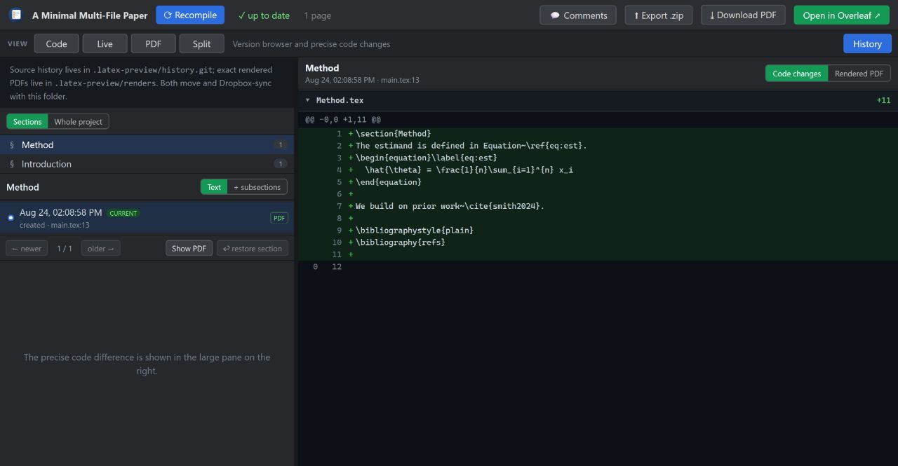

# TeXChronicle — User guide

**English** · [简体中文](i18n/USER-GUIDE.zh-CN.md) · [日本語](i18n/USER-GUIDE.ja.md) · [한국어](i18n/USER-GUIDE.ko.md) · [Español](i18n/USER-GUIDE.es.md) · [Français](i18n/USER-GUIDE.fr.md) · [Deutsch](i18n/USER-GUIDE.de.md) · [Português](i18n/USER-GUIDE.pt.md)



## Everyday use

1. Add the server to your paper project's `.mcp.json`, restart Claude Code. Until the npm
   release that entry installs from GitHub — `"command": "npx", "args": ["-y",
   "github:Aliutin/TeXChronicle"]`; see the
   [README](../README.md#setup-with-an-llmmcp-client) for the source-checkout alternative
   and what the GitHub install costs. Or install the plugin for slash commands (below).
2. Ask your connected agent to *"render a preview"* (or run `/texchronicle`). The **workspace** opens: a
   top-level view switch gives **Code**, a source-preserving **Live visual editor**, the exact compiled
   **PDF**, and **Split** for source + PDF together. **History** is beside them; toggle
   💬 **Comments** in the top bar whenever you need the review drawer.
3. From then on the PDF stays live. Your own editor's saves and Claude's edits auto-recompile;
   in the built-in editor you press **Ctrl+S** / **Recompile** to rebuild (it auto-saves your
   work every 30s without recompiling).
4. **Click a point in the live PDF** to open its source file and line. A local TeX build uses
   its real SyncTeX map; bundled-WASM and older historical PDFs fall back to visible-text
   matching. In focused PDF view the click opens Code at that line. Drag-selecting text still
   opens the comment composer instead of navigating.

## Slash commands (plugin)

Install once — `/plugin marketplace add Aliutin/TeXChronicle` then `/plugin install texchronicle` —
and drive it with minimal typing:

- **`/texchronicle`** — compile and open the workspace.
- **`/ai-review [skill]`** — review the paper with a skill (default `academic-paper-revision`;
  any skill name works) and post comments for you to accept.
- **`/address-comments`** — resolve your accepted comments (loop it: `/loop 60s /address-comments`).
- ⚡ **`/ultra-agents [skill] [depth]`** — fully autonomous: review, auto-accept, fix, repeat, up
  to `depth` rounds (default 2), stopping early the moment a round finds nothing new. No
  per-round approval — that's the point, and the risk. See
  [`AGENT-LOOP.md`](AGENT-LOOP.md#ultra-agents).

### One command per tool

Every MCP tool also has a slash command with the **same name** — so any single step
is one command away. The rule to teach anyone: *the tool is `X` → type `/X`.*

| Type this | Runs tool | What it does |
| --- | --- | --- |
| `/render_preview` | `render_preview` | Compile the paper and open/refresh the live preview. |
| `/check_comments` | `check_comments` | List the comments you've accepted, as edit instructions (no edits yet). |
| `/resolve_comment [id] [note]` | `resolve_comment` | Mark a comment done after the edit; it turns **green** for your review. |
| `/add_comment ["quote"] [note]` | `add_comment` | Anchor a comment onto a passage for you to Accept/Reject. |
| `/reply_to_comment [id] [text]` | `reply_to_comment` | Add a threaded reply to a comment. |
| `/show_diff [checkpoint]` | `show_diff` | Side-by-side visual diff as an image (current changes, or a checkpoint). |
| `/list_checkpoints [limit]` | `list_checkpoints` | Recent checkpoints with their sha, newest first — find one to pass into `/show_diff`. |

You never *have* to type these — plain English works too (*"render a preview"*,
*"address my comments"*). The commands are just a fast, teachable shorthand.

## The comment loop (review on the PDF, Claude edits the source)

1. **Select text on the rendered PDF** → a composer pops up → write what you want changed
   ("tighten this paragraph", "this equation looks wrong") → **Add comment**. The passage
   gets an anchored highlight; the card appears in the right panel as *accepted*.
2. In Claude Code, say *"address my comments"*. Claude calls `check_comments` (each comment
   arrives with its page, the exact quoted passage, and your instruction), edits the source,
   and calls `resolve_comment` with a one-line note.
3. The PDF recompiles, the card flips to *resolved ✓* with Claude's note, and the History tab
   holds the checkpoint diff of what changed.

You never have to touch LaTeX — you point at the document; Claude works on the source.

## The review workflow (reviewer → you gate → author resolves)

You can also let an agent *raise* the comments, and keep yourself in the loop:

1. **Reviewer pass.** Run `/ai-review academic-paper-revision` (or point it at any review skill).
   The agent reads the paper and calls `add_comment` for each issue — they appear as **Suggested**
   cards (purple dashed highlights on the PDF), tagged **reviewer** or **defender**.
2. **You gate.** In the Comments panel, **Accept** the ones you agree with (they become actionable
   *accepted*), **Reject** the rest, or add your own. Prefer hands-off? Tick **Auto-accept reviewer
   suggestions (copilot)** and every suggestion is accepted automatically.
3. **Author resolves.** Run `/address-comments` (or loop it). The author edits each accepted comment
   at its source location and marks it resolved with a note.

Comments have a **reply thread** (you and the agents can discuss before resolving). When Claude
resolves one, its highlight turns **green** (the edit is done, awaiting *your* review) and the card
moves to the *Resolved* list. Reviewing is one-by-one: **Close** a resolved comment once you've
checked the edit and its green highlight disappears — that's the human-confirmed step, so colors
clear as you go instead of piling up. **clear all** closes them in bulk.

### Why a highlight can sit slightly off the text

Highlights are drawn from pdf.js's invisible *text layer* (the same geometry used for selection),
which is a per-line approximation of where the glyphs are painted on the canvas — so a box can be a
hair off, more visible when zoomed in. That small offset is inherent and cosmetic. To avoid the
larger drift that used to happen after Claude edited a passage and the PDF reflowed, TeXChronicle
**re-anchors each highlight onto the current text** on every recompile (matching the comment's
quoted head and tail phrases) rather than pinning it to old coordinates — so it follows the text
even when the words in the middle changed. If a passage is deleted or rewritten past recognition,
the highlight falls back to its last known position.

## Live visual editor

Choose **Live** at the top to edit the current source as a document rather than as code. Click ordinary
prose—including headings, emphasized text, list items, captions, table cells, and footnotes—and type
directly. Enter creates a new paragraph. The change is projected back onto the smallest exact source
span, so untouched whitespace and typography are not regenerated and surrounding citations, math,
references, macro names, braces, and comments remain intact.

Rendered math, citations, references, and other protected constructs remain visible but are not
flattened into text. Use the paper-margin line number or **Edit Code** when you need to change their
exact LaTeX. The Code editor stays mounted behind Live, preserving the current buffer and history.
Ordinary `\input`/`\include` files are rendered with file-and-line mappings; clicking editable text
from another file first binds the editor to that file, then the second click edits it safely.

Live updates without running TeX and renders titles, numbered headings, paragraphs, emphasis,
citations and references, footnotes, lists, KaTeX equations, figures, and ordinary tables. Unknown
project macros are approximated locally instead of blanking the whole document, and the status bar
lists how many constructs were approximated.

**Ctrl+S** saves from Live as well as from Code — the same save-and-recompile the Code editor does,
without switching tabs first.

Live is a semantic editor, not a second TeX engine. Use **PDF** for authoritative
pagination, fonts, floating placement, complex tables, TikZ, and final visual review. The PDF view
paints pages on demand — the ones on screen plus a couple either side — rather than rasterising the
whole document first, so an eighty-page paper opens straight away instead of sitting blank while
every page is drawn. **⏎ Wrap** in
Code wraps long source lines without changing the file.

## The file tree

The **FILES** panel is a full tree: expand folders, click a file to switch to it, and use
**+ File / + Folder** or a row's rename/delete. Drag the divider below it to resize.

## The source editor

The left panel's **Source** tab lists the project's text files in a CodeMirror LaTeX editor.
**Ctrl+S** (or Save) writes to disk — the watcher recompiles and the PDF refreshes, exactly
like Typst's editor loop. Prefer your own editor? Saves from anywhere trigger the same loop.

### Seeing a diff inside the conversation

Ask Claude *"show me the diff"* (or *"show the diff of the last checkpoint"*) and it uses the
`show_diff` tool to return a **side-by-side diff as an image, right in the chat**. This exists
because Claude Code has no diff-viewer of its own — if Claude just runs `git diff`, it captures
the text and summarizes it. `show_diff` gives you the actual visual split instead. (For the same
diff *next to the rendered PDF*, use the browser History panel; for a terminal split, `git diff`
with [delta](https://github.com/dandavison/delta) configured.)

## Section history

Every clean PDF render creates a source checkpoint. Open **History → Sections** to browse the
paper as a section tree rather than as a list of whole-document commits. Selecting an
Introduction, subsection, or appendix shows only the versions in which that part changed.
The tree follows the rendered main document and its `\input`/`\include` files; unrelated old
drafts or supplements kept in the same folder are not mixed into it.

- **Text** compares the heading and prose owned directly by that section, without noise from
  edited subsections. **+ subsections** compares its complete subtree.
- **View PDF** opens the exact PDF saved when that source checkpoint rendered; **Back to latest**
  returns to the live preview.
- **Restore section** replaces only that section and its subsections. TeXChronicle checkpoints the
  current project first, so the restore itself is reversible. Use **Whole project** when you
  really want a full checkpoint diff or restore.

Identity is semantic rather than tied to line numbers. A stable `\label{...}` is the strongest
signal, but it is not required: titles, direct prose, hierarchy, neighbouring headings, file,
and order are combined to follow renamed or moved sections. A **?** badge marks a low-confidence
fuzzy match so you know to inspect that transition rather than trust it silently.

The source history lives in the hidden Git ref described below. Exact PDFs live beside it at
`.latex-preview/renders/<checkpoint>.pdf`; they are excluded from Git because binary PDF deltas
grow quickly. The **newest 50 are kept** and older ones deleted, so a figure-heavy paper no longer
accumulates a full PDF per save inside a synced folder; the render currently on screen is always
kept, however old it is. Set `TEXCHRONICLE_KEEP_RENDERS` to a different number to change the limit,
or to `0` to keep every one. Deleting old `.latex-preview/renders/*.pdf` by hand is safe too — the
only thing that stops working is **View PDF** for those checkpoints, and the source history is
untouched. Both are inside the
project folder for plain-folder projects, so Dropbox can carry
them across machines. Let Dropbox finish syncing before opening the same project elsewhere, and
avoid editing it concurrently on two machines; a normal Git remote is safer for concurrent source
work.

## Getting your paper into Overleaf

There are three ways, depending on your setup. The tool can't push to Overleaf *for* you without
your credentials, so these keep you in control.

### 1. Upload a clean zip (works for everyone)

Click **⬆ Export .zip**. You get a zip containing only the build inputs — `.tex`, `.bib`,
`.cls`/`.sty`/`.bst`, and figures — with build artifacts (`.aux`, `.log`, the compiled PDF),
`.git/`, and `node_modules/` left out. In Overleaf: **New Project → Upload Project**, drop the zip.

This is the reliable, universal path — no account linking, no public repo needed.

### 2. One-click "Open in Overleaf" (public GitHub repos)

If your project is a git repo with a **public** GitHub `origin`, the toolbar shows
**Open in Overleaf ↗**. Clicking it asks Overleaf to import your repo's current-branch archive
directly — a new project, one click. It only works if the repo is public, because Overleaf's
servers fetch the archive over the internet.

### 3. Sync to an existing Overleaf project (Overleaf Premium — Git bridge)

Overleaf Premium exposes each project as a git remote. Set it up once, yourself (your token is a
credential the tool never handles):

```bash
git remote add overleaf https://git.overleaf.com/<your-project-id>
# use your Overleaf git token when git prompts for a password
git push overleaf <branch>
```

After that, publishing an update is just `git push overleaf` — you can ask Claude to run it.

## Package coverage

The WASM engine ships a **subset** of TeX Live (basic + recommended + extra). Most common
packages are included. A few common omissions are handled automatically:
- the `algorithm`/`algorithmicx` family and `multirow` — the real `.sty` are vendored
  (verbatim, LPPL) and injected;
- `bbm` — a small **preview shim** approximates `\mathbbm` (letters via `\mathbb`, the
  `\mathbbm{1}` indicator via a poor-man's double-struck 1), so the paper still renders.

Anything else that's outside the subset and font-based will fail with `File '<pkg>.sty' not
found`. If you hit that, drop the package's `.sty` (and fonts) into your project, or adjust the
preamble. Either way, your final compile on Overleaf uses the real packages — the local preview
is an approximation.

A `.cls`, `.sty`, `.bst` or `.bib` you ship in a **subdirectory** counts as being in your project:
both backends now search the project's own folders, so `styles/myvenue.cls` with
`\documentclass{myvenue}`, or `bib/refs.bib` with `\bibliography{refs}`, resolves without moving
the file to the root. (TeX itself does not look inside subdirectories, which is why this used to
fail with the file demonstrably right there — and why the bibliography case failed silently.)

## Environment variables

None of these are required — TeXChronicle works with all of them unset. Set them in your
shell, or in the `"env"` block of the server's entry in `.mcp.json`.

| Variable | What it does |
| --- | --- |
| `TEXCHRONICLE_PROJECT` | The paper folder to work on, when the server was not started in it. Lowest precedence of the three ways: a `--project <dir>` argument wins over it, and a `projectRoot` passed to `render_preview` re-points the whole session over both. |
| `TEXCHRONICLE_ASSETS_DIR` | Where the one-time WASM TeX Live assets (~650 MB) live. Defaults to a per-user cache, so a checkout, a global install and an `npx` run share one copy. (`MAGICTEX_ASSETS_DIR` is still read as a migration alias.) |
| `TEXCHRONICLE_KEEP_RENDERS` | How many historical render PDFs to keep in `.latex-preview/renders/`. Default 50; `0` keeps every one. The render on screen is never deleted. |
| `TEXCHRONICLE_NO_OPEN` | Set to `1` to keep TeXChronicle from opening a browser tab. The workspace still runs and prints its URL — for headless machines, remote sessions, and tests. |
| `TEXCHRONICLE_SKIP_BROWSER_DOWNLOAD` | Set to `1` to skip the automatic Playwright Chromium download that runs at install time and is retried the first time a preview needs a browser. Playwright's own `PLAYWRIGHT_SKIP_BROWSER_DOWNLOAD=1` does the same. (`0`, `false` and empty do not count as set.) With no Chromium, TeXChronicle falls back to an installed Chrome or Edge. |
| `TEXCHRONICLE_BROWSER` | Which browser to drive, tried before everything else: `chrome`, `msedge`, `chromium`, or the full path to an executable. The order otherwise is the downloaded headless Chromium, then that download, then an installed Chrome, then Edge. |

## Notes

- The compiled PDF is an approximation of what Overleaf produces (a current TeX Live via WASM),
  not a guaranteed bit-identical match. It's accurate for the vast majority of papers; always do
  a final compile on your target (Overleaf or your submission system).
- Change history is stored under a hidden git ref (`refs/latex-preview/checkpoints`) and never
  touches your branches, `git log`, or working tree. If the folder isn't a git repository,
  TeXChronicle keeps that ref in a repository of its own at `.latex-preview/history.git` inside the
  project — so the history moves, copies and is deleted with the folder, and `git` run there still
  reports no repository.
- Historical PDFs are stored separately under `.latex-preview/renders/`, keyed by checkpoint SHA,
  and are not added to either your Git history or TeXChronicle's hidden source history. The newest
  50 are kept; `TEXCHRONICLE_KEEP_RENDERS` sets a different number, and `0` keeps all of them.
- If Dropbox (or another sync tool) ever collides on the checkpoint ref itself, it leaves a
  "conflicted copy" beside it. TeXChronicle keeps whatever that copy pointed at under
  `refs/latex-preview/recovered/…` rather than letting it be garbage-collected, so the other
  machine's checkpoints are still reachable instead of silently gone.
